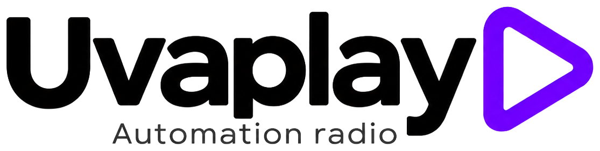
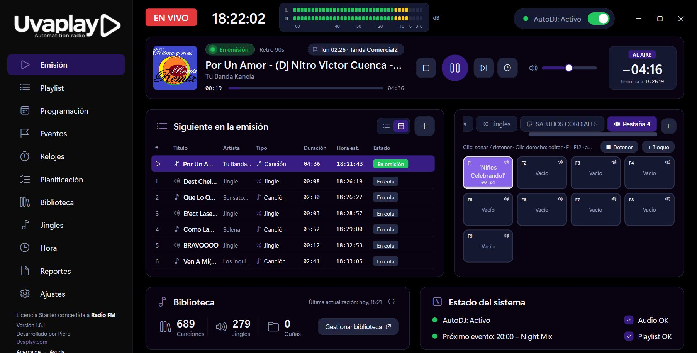
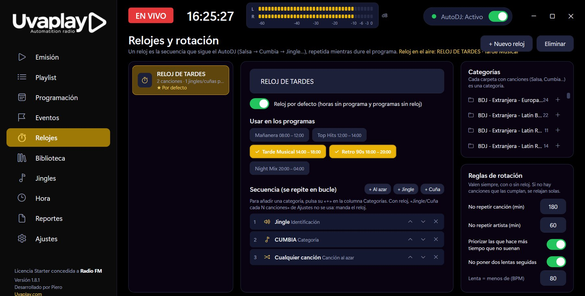
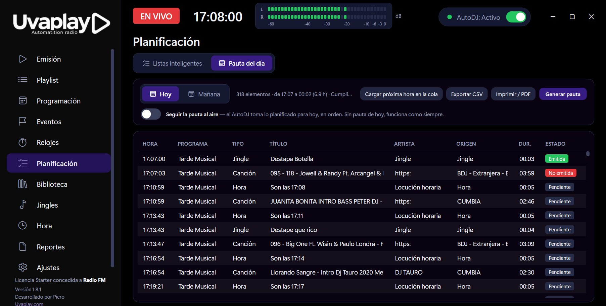
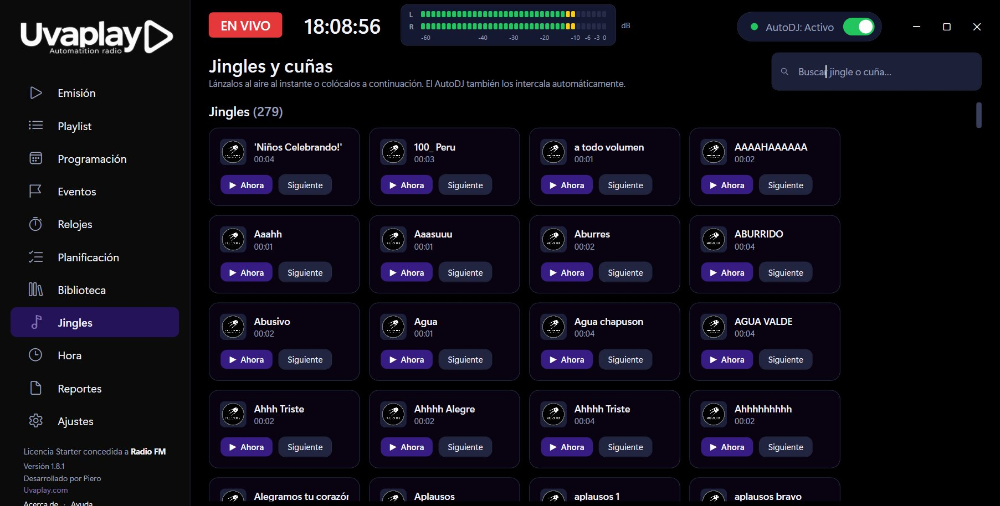

  

<h1 align="center">UVA RadioPlay</h1>

  <b>Automatización de radio para Windows: tu radio al aire las 24 horas, sonando como una profesional.</b>

  

  Windows 10 y 11 (64 bits) ·
  <a href="https://github.com/uvaplay/UvaRadioPlay/releases/latest">Novedades de la versión</a> ·
  <a href="https://radio.uvaplay.com">radio.uvaplay.com</a>

  

UVA RadioPlay elige la música, lanza tus tandas a su hora, da la hora encima de la canción, transmite tu señal por internet y deja todo registrado para tus anunciantes. Tú intervienes en directo cuando quieras.

## Descargar

**[⬇️ Descargar UVA RadioPlay (última versión)](https://github.com/uvaplay/UvaRadioPlay/releases/latest/download/UvaRadioPlay-Setup.exe)**

También en **[Releases](https://github.com/uvaplay/UvaRadioPlay/releases/latest)**, con las novedades de cada versión.

- Windows 10 y 11 (64 bits). El instalador incluye todo lo necesario.
- Necesitas una licencia: tu correo registrado en [uvaplay.com](https://uvaplay.com).

### Cómo instalar

1. Abre el archivo descargado.
2. Si Windows muestra **"Windows protegió su PC"**, pulsa **Más información → Ejecutar de todas formas**.
3. Escribe el **correo de tu licencia** y pulsa **Activar e instalar**.
4. Termina el asistente y abre UVA RadioPlay.

¿Ya lo tienes instalado? Instala la versión nueva encima: tus ajustes, programación y licencia se conservan.

## Funciones

- **AutoDJ inteligente**: elige la música solo, sin repetir canciones ni artistas antes de tiempo.
- **Programación por horario**: programas del día, relojes que definen cómo suena cada hora y pauta diaria imprimible.
- **Eventos y tandas**: a horas fijas, cada X minutos o cada X canciones. Tandas, cuñas en rotación sin repetir, pisadores al inicio o al final de la canción, locución horaria y enlaces de streaming.
- **Directo sin estrés**: botonera con pestañas y teclas F1–F12, jingles encima de la música, notas, pre-escucha por otra tarjeta y la hora al instante con <kbd>Ctrl</kbd>+<kbd>H</kbd>.
- **Consola en pantalla**: bloques separados para lo que suena, la consola (perillas de volumen, monitor y fundido automático, y faders de entrada y corte) y el cartel «AL AIRE», todo con el color de tu tema.
- **Plugins integrados**: se activan cuando los necesitas. **DJ PODER MIC** mete tu micrófono a la mezcla y baja la música sola mientras hablas, con vúmetro LED y atajo <kbd>Ctrl</kbd>+<kbd>M</kbd>.
- **Streaming incluido**: Shoutcast v1 y v2 en MP3, AAC y AAC+, a varios servidores y calidades a la vez, con volumen propio, frecuencia de muestreo por salida, título de la canción y reconexión automática.
- **Bibliotecas grandes**: elige qué carpetas de música usar, sin duplicados, con escaneo rápido y barra de progreso, pensado para cientos de miles de canciones. Busca por título, artista o nombre de archivo y **filtra por año o por década**.
- **Listas M3U enormes**: se cargan en segundo plano con barra de progreso, sin detener la emisión.
- **Sonido de radio**: volumen igualado (LUFS, sin tocar tus archivos), silencios recortados, crossfade, fundidos de entrada y corte, y procesador con ecualizador, AGC, multibanda y limitador.
- **Control y reportes**: vúmetro real, monitor del equipo y reporte diario en CSV para anunciantes.
- **Hecho para no fallar**: guardado cada 5 segundos y, si el programa se reinicia, continúa la misma canción desde donde iba.

  
  

  

## Licencia

UVA RadioPlay es software propietario de Uvaplay.com. Este repositorio solo contiene la presentación y los instaladores publicados; el código fuente no es público.
